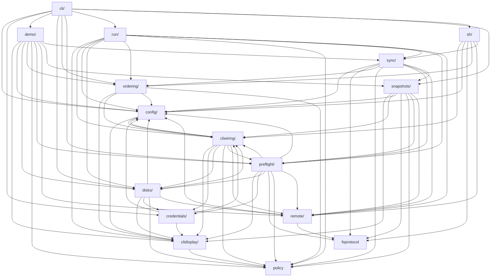

# Architecture

How nbkp is composed: the external tools it orchestrates (**Building Blocks**, below) and the module-level dependency graph (further down) for contributors navigating the codebase.

For the domain model, see [Domain](./domain.md); for every config field, see the [Configuration Reference](./config-reference.md). For runtime behavior and design decisions, see [Internals](./internals.md).

## Building Blocks

nbkp is a thin orchestrator over proven, standard tools — no custom storage format, transfer protocol, or encryption. It composes the following and defers to each for the hard parts:

### Data transfer

- **rsync** — does the actual file copy (incremental, delete-aware, filter rules), locally and over SSH. Files land as plain directories, so restoring is just a copy. Flag defaults and the `--hard-links` rationale: [Rsync Defaults](./internals.md#rsync-defaults); exact invocations: [Rsync synchronization](./internals.md#rsync-synchronization).
- **SSH** — transport and remote control. rsync runs over the OpenSSH `ssh` client (`-e ssh`, proxy-jump chains), while preflight checks, snapshot operations, and the mount lifecycle run remote commands via Fabric/Paramiko. The best reachable endpoint is chosen per run: [Endpoint Filtering](./internals.md#endpoint-filtering); SSH option mapping: [SSH transport](./internals.md#ssh-transport).

### Mount management (Linux)

- **udisks2** (`udisksctl`) — the single backend for the unlock → mount → umount → lock lifecycle of removable and encrypted drives, on local and remote hosts alike. No `sudo` and no `systemctl` in the mount path: [Volume Mount Management](./internals.md#volume-mount-management), [Why udisks2](./internals.md#why-udisks2).
- **polkit** — the *only* authorization mechanism for udisks. A single generated rule (`50-nbkp.rules`) lets the backup user unlock/mount/lock without a password — required because nbkp runs over SSH or from a timer in an inactive session: [Why polkit-only](./internals.md#why-polkit-only).
- **LUKS / dm-crypt** (`cryptsetup`) — full-volume encryption at rest for backup destinations; nbkp has no encryption of its own ([Encryption](./domain.md#encryption)). At runtime nbkp never calls `cryptsetup` directly: udisks unlocks/locks the container and nbkp discovers the cleartext device, so the operator only uses `cryptsetup` once, to create the LUKS volume: [Volume Mount Management → Encrypted volumes](./internals.md#volume-mount-management), [Why no `dm-crypt` kernel module check](./internals.md#why-no-dm-crypt-kernel-module-check).

### Snapshots

- **btrfs** (`btrfs-progs`) — copy-on-write, space-efficient point-in-time snapshots: rsync writes to a `staging` subvolume, then a read-only snapshot is taken. Pruning needs the `user_subvol_rm_allowed` mount option: [Snapshot Lifecycle](./internals.md#snapshot-lifecycle), [Btrfs snapshot operations](./internals.md#btrfs-snapshot-operations).
- **Hard links** — the filesystem-agnostic alternative to btrfs snapshots: rsync `--link-dest` references the previous snapshot so unchanged files are shared. Works on any filesystem with hard-link support: [Snapshot Lifecycle](./internals.md#snapshot-lifecycle), [Hard-link snapshot operations](./internals.md#hard-link-snapshot-operations).

### Discovery & safety

- **Sentinel files** (`.nbkp-vol` / `.nbkp-src` / `.nbkp-dst`) — nbkp's own guard, not an external tool: a sync runs only when all its sentinels are present, so an unmounted or wrong drive is skipped rather than written to: [Sentinels](./domain.md#sentinels-presence-is-proven).
- **util-linux / coreutils** (`findmnt`, `lsblk`, `stat`, `which`, `test`, …) — the small probes behind preflight and mount discovery: `findmnt` (where a device is mounted + live mount options), `lsblk` (the unlocked cleartext device), `stat` (btrfs detection). Their availability is itself checked: [Pre-flight Checks](./internals.md#pre-flight-checks); the full command list is in the [External Commands Reference](./internals.md#external-commands-reference).

### Credentials

- **keyring** (OS secret stores: macOS Keychain, Linux SecretService, …) — the default source for LUKS passphrases. They stay on the operator's machine and are delivered to the server only transiently at unlock time, never stored server-side: [Why keyring as the default credential provider](./internals.md#why-keyring-as-the-default-credential-provider).

<!-- BEGIN MODULE OVERVIEW (auto-generated by: mise run depgraph — do not edit manually) -->
## Module Overview

Dependencies between top-level modules (auto-generated via `mise run depgraph`):

<!-- END MODULE OVERVIEW -->

### Layering

Each domain module (`disks/`, `preflight/`, `snapshots/`, …) keeps its core logic, its presentation (`output.py` / `output/`), and its Typer sub-app (`cli/`) side by side. These rules keep them decoupled, and `mise run lint-imports` (part of `mise run check`) enforces them through the [import-linter](https://import-linter.readthedocs.io/) contracts in `pyproject.toml` (`[tool.importlinter]`). The generated graph above only *shows* dependencies; the contracts are what reject a new import that breaks a rule:

- **No module imports another module's `cli/` package.** Wiring that several sub-apps need — loading the config (`load_config_or_exit`), resolving endpoints, the managed mount lifecycle and its progress bars, and preflight checks with progress — lives in `cliwiring/`, which only `cli/` sub-apps import. Only the root `cli/` app imports the sub-apps.
- **Decisions live in core, display in `clidisplay/`.** `policy` holds `Strictness`, `Severity` and `classify_severity` — whether a finding is fatal — and is what core modules (`sync/`, `run/`, `preflight/`, `disks/`) import. `clidisplay/` is presentation only (output format, JSON, severity symbols and styles, progress bars, and the `Invocation` that echoes the current flags in suggested follow-up commands); core modules import neither it nor `rich` / `typer`. The `prompt` credential provider gets its terminal prompt injected from `cliwiring/credentials.py`. The two-way edges between `cliwiring/` and the modules in the graph above are between a module's `cli/` subpackage and `cliwiring/`, never with the module's core: the sub-apps sit above `cliwiring/`, the module cores below it. Importing a core package (`nbkp.disks`, `nbkp.preflight`, `nbkp.sync`, …) loads neither Rich nor Typer: presentation is imported explicitly from `output` modules.
- **`config/` is the base layer.** Its core (models, loader) imports nothing else from nbkp. Endpoint selection — the `EndpointFilter` / `ResolvedEndpoint` models (`remote/endpoints.py`) and the algorithm (`remote/resolution.py`) — lives in `remote/`; config's display code takes the selected endpoints through a structural protocol rather than importing them. Transport primitives (`run_on_volume`, `check_command_available`) are in `remote/dispatch.py`; preflight-only host probes (sentinels, directories, symlinks, rsync version) are in `preflight/probes.py`.
- **`clidisplay/` is a presentation leaf.** It imports nothing from nbkp but `policy`.
- **Test and demo fixtures (`testkit`) are exempt.** They build scenarios across modules for the tests and `nbkp demo`, and are not runtime code.

### Package Map

Where each concern lives, ordered by the layers above, from the base up:

| Layer | Packages | Contents |
|---|---|---|
| Base | `config/` | Config models (`config/protocol/`: one module per entity, plus `errors.py` for validation codes) and the YAML `loader.py` |
| Shared leaves | `policy.py`, `fsprotocol.py` | `policy`: strictness and severity classification. `fsprotocol`: sentinel names, directory layout, snapshot types |
| Transport | `remote/` | Endpoint models and selection (`endpoints.py`, `resolution.py`), SSH argument building (`ssh.py`), Fabric/Paramiko (`fabricssh.py`), transport primitives (`dispatch.py`) |
| Domain cores | `credentials/`, `disks/`, `preflight/`, `snapshots/`, `sync/`, `ordering/`, `run/`, `sh/` | The behavior of each command, described below |
| CLI wiring | `cliwiring/` | Wiring shared by sub-apps: config loading, credential prompting, the mount lifecycle and its progress bars, preflight with progress |
| Presentation | `clidisplay/` | Output format, JSON, severity display, progress bars, `Invocation` |
| Root app | `cli/` | The top-level Typer app (`app.py`), which mounts every sub-app |

Domain cores:

- **`credentials/`** — LUKS passphrase providers (keyring, env, command, prompt) and the per-run cache.
- **`disks/`** — the udisks mount lifecycle: device detection and observation (`detection.py`, `observation.py`), unlock/mount/umount/lock (`udisks.py`, `lifecycle.py`, `context.py`), dry-run planning (`plan.py`), mount checks, and polkit rule generation (`auth.py`).
- **`preflight/`** — the two-layer check system described in [Preflight Conditional Probing](./internals.md#preflight-conditional-probing): observation (`probes.py`, `volume_checks.py`, `endpoint_checks.py`, `ssh_checks.py`, `snapshot_checks.py`) and interpretation (`status/`, one module per layer). `output/` renders `check` and `troubleshoot`, including remediation text.
- **`snapshots/`** — listing, creation and pruning for both backends (`btrfs.py`, `hardlinks.py`, shared code in `common.py`).
- **`sync/`** — rsync command building (`rsync.py`), orchestration and results (`orchestration.py`, `results.py`), and one module per snapshot mode in `modes/` (`plain`, `btrfs`, `hardlink`).
- **`ordering/`** — the backup graph and its topological order (`graph.py`).
- **`run/`** — the `nbkp run` pipeline (`pipeline.py`): prefetch, mount, preflight, sync, unmount.
- **`sh/`** — standalone script generation: per-sync facts (`spec.py`), preflight and sync steps (`preflight.py`, `steps.py`), shell quoting (`quoting.py`), and the `backup.sh.j2` template.

Outside the runtime layers, `demo/` implements `nbkp demo`, and the testkits (`remote/testkit/` for Docker and SSH fixtures, `sync/testkit/` for seeding and result helpers, `config/testkit.py`, `preflight/testkit.py`) supply test scenarios.
